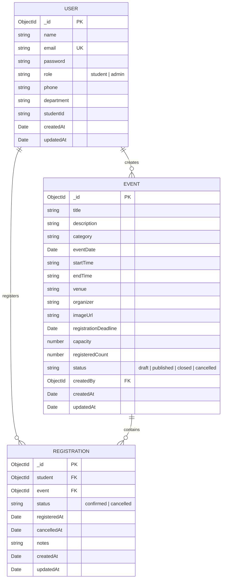

# Database Schema Specification

## Campus Event Registration and Management System

### 1. Database Overview
- **Database Engine:** MongoDB (Document-Oriented NoSQL)
- **Object Data Modeling (ODM):** Mongoose v8.x
- **Database Name:** `campus_events`
- **Charset / Collation:** UTF-8 default MongoDB collation

---

### 2. Entity Relationship Diagram (ERD)



---

### 3. Collections and Field Definitions

#### 3.1 Users Collection (`users`)
Stores both student attendees and campus administrator accounts.

| Field Name | Type | Index | Required | Default | Description |
| :--- | :--- | :--- | :--- | :--- | :--- |
| `_id` | ObjectId | Primary Key | Yes | Auto | Unique MongoDB Identifier |
| `name` | String | No | Yes | None | Full legal or college name (2-60 chars) |
| `email` | String | Unique | Yes | None | Trimmed, lowercased email address |
| `password` | String | No | Yes | None | Bcrypt hashed password (10 salt rounds) |
| `role` | String | Yes | Yes | `student` | Role discriminator: `student` or `admin` |
| `phone` | String | No | No | `""` | Student contact telephone number |
| `department` | String | No | No | `CSE` | College branch or department |
| `studentId` | String | No | No | `""` | College Roll Number / Student ID |
| `createdAt` | Date | No | Auto | Now | Timestamp of profile registration |
| `updatedAt` | Date | No | Auto | Now | Timestamp of last profile update |

**Indexes on Users:**
- `email`: `{ email: 1 }`, Unique: true

---

#### 3.2 Events Collection (`events`)
Stores curated campus symposiums, hackathons, workshops, and galas.

| Field Name | Type | Index | Required | Default | Description |
| :--- | :--- | :--- | :--- | :--- | :--- |
| `_id` | ObjectId | Primary Key | Yes | Auto | Unique Event identifier |
| `title` | String | Text Index | Yes | None | Event title (3-120 chars) |
| `description` | String | Text Index | Yes | None | Comprehensive event syllabus & details |
| `category` | String | Single Index | Yes | `Technical` | Enum: Technical, Cultural, Sports, Workshop, Seminar, Hackathon, Other |
| `eventDate` | Date | Compound | Yes | None | Official date the event convenes |
| `startTime` | String | No | Yes | None | Event commencement time (e.g., `09:30 AM`) |
| `endTime` | String | No | Yes | None | Event conclusion time (e.g., `04:30 PM`) |
| `venue` | String | Text Index | Yes | None | Campus hall, auditorium, or lab location |
| `organizer` | String | No | Yes | Campus Org | Department or student club organizer |
| `imageUrl` | String | No | No | Default CDN | High-resolution banner image URL |
| `registrationDeadline` | Date | No | Yes | None | Cut-off timestamp for seat bookings |
| `capacity` | Number | No | Yes | None | Maximum permitted attendees (>= 1) |
| `registeredCount` | Number | No | No | 0 | Current confirmed attendee count |
| `status` | String | Compound | Yes | `published` | Enum: `draft`, `published`, `closed`, `cancelled` |
| `createdBy` | ObjectId | Reference | No | None | Admin User `_id` who published the event |
| `createdAt` | Date | No | Auto | Now | Timestamp of creation |
| `updatedAt` | Date | No | Auto | Now | Timestamp of last update |

**Indexes on Events:**
- Compound: `{ eventDate: 1, status: 1 }` (Optimizes chronological public feed queries)
- Single: `{ category: 1 }` (Optimizes category filter queries)
- Text Index: `{ title: 'text', description: 'text', venue: 'text' }` (Optimizes keyword search)

**Virtual Properties:**
- `remainingSeats`: `Math.max(0, capacity - registeredCount)`
- `isRegistrationOpen`: `status === 'published' && now <= registrationDeadline && registeredCount < capacity`

---

#### 3.3 Registrations Collection (`registrations`)
Stores student seat reservations, booking status, and audit timestamps.

| Field Name | Type | Index | Required | Default | Description |
| :--- | :--- | :--- | :--- | :--- | :--- |
| `_id` | ObjectId | Primary Key | Yes | Auto | Unique Registration record ID |
| `student` | ObjectId | Compound Unique | Yes | None | Reference to `User._id` (Student) |
| `event` | ObjectId | Compound Unique | Yes | None | Reference to `Event._id` |
| `status` | String | Single Index | Yes | `confirmed` | Enum: `confirmed`, `cancelled` |
| `registeredAt` | Date | Single Index | Yes | Now | Timestamp seat was reserved |
| `cancelledAt` | Date | No | No | None | Timestamp seat was relinquished |
| `notes` | String | No | No | `""` | Optional attendee dietary/team requirements |
| `createdAt` | Date | No | Auto | Now | Document creation timestamp |
| `updatedAt` | Date | No | Auto | Now | Document modification timestamp |

**Indexes on Registrations:**
- Compound Unique: `{ student: 1, event: 1 }`, Unique: true. Enforces database-level constraint preventing duplicate registrations.
- Single: `{ student: 1 }` (Optimizes "My Registrations" query)
- Single: `{ event: 1 }` (Optimizes "Event Attendee Roster" query)

---

### 4. Concurrency & Data Integrity Strategy

1. **Atomic Capacity Reservation:**
   Seat reservation does not rely on a two-step "read then write". Instead, it utilizes MongoDB atomic conditional updates:
   ```javascript
   const updated = await Event.findOneAndUpdate(
     {
       _id: eventId,
       status: 'published',
       $expr: { $lt: ['$registeredCount', '$capacity'] }
     },
     { $inc: { registeredCount: 1 } },
     { new: true }
   );
   ```
   If concurrent requests attempt to reserve the final available seat, only one operation matches the query `$expr: { $lt: ['$registeredCount', '$capacity'] }`. All other operations receive `null` and return an immediate `400 Event Full` status, completely preventing overselling.

2. **Rollback Safety:**
   If the subsequent `Registration.create()` fails (e.g. database network interruption or unique compound index violation), an atomic compensating decrement `{ $inc: { registeredCount: -1 } }` is immediately executed.

3. **Atomic Cancellation:**
   When a student cancels an eligible seat, the registration status is updated to `cancelled` and the event capacity is decremented atomically via `{ $inc: { registeredCount: -1 } }`.
