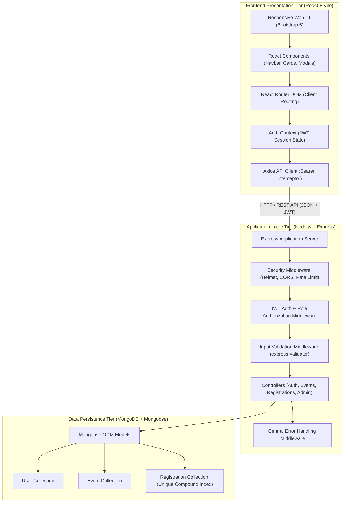
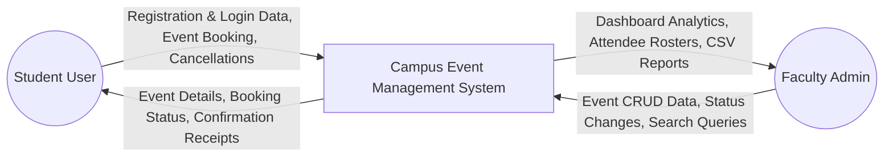
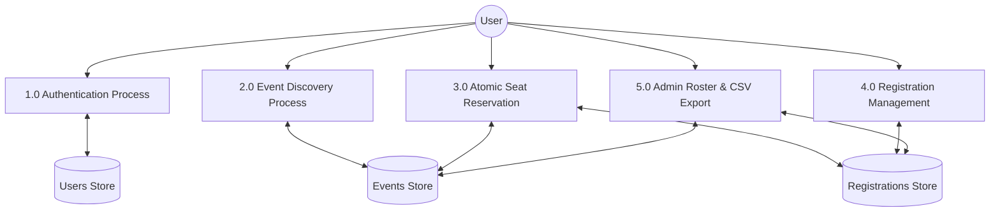
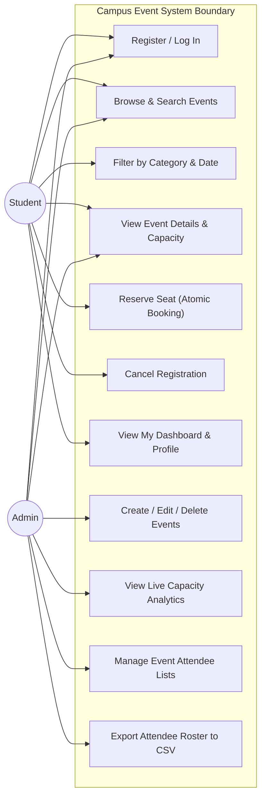

# ACADEMIC PROJECT REPORT

## CAMPUS EVENT REGISTRATION AND MANAGEMENT SYSTEM

**A Web Technology Capstone Project Report submitted in partial fulfillment of the requirements for the Degree of Bachelor of Technology / Bachelor of Engineering in Computer Science & Engineering / Information Technology.**

---

### CANDIDATE & INSTITUTION DETAILS
*(Please edit the placeholders below with your personal and college details)*

- **Student Name:** [YOUR FULL NAME]
- **Register / Roll Number:** [YOUR REGISTRATION NUMBER]
- **Degree & Branch:** B.Tech / B.E. in Computer Science and Engineering
- **Department:** Department of Computer Science & Engineering
- **Institution / University:** [NAME OF YOUR COLLEGE / UNIVERSITY]
- **Academic Year:** 2025 – 2026
- **Project Supervisor / Faculty Guide:** [NAME & DESIGNATION OF FACULTY GUIDE]
- **Date of Submission:** [DATE OF SUBMISSION]

---

### TABLE OF CONTENTS
1. [Abstract](#1-abstract)
2. [Introduction](#2-introduction)
3. [Problem Statement](#3-problem-statement)
4. [Objectives](#4-objectives)
5. [Existing System vs Proposed System](#5-existing-system-vs-proposed-system)
6. [Hardware & Software Requirements](#6-hardware--software-requirements)
7. [System Architecture & Design](#7-system-architecture--design)
8. [Data Flow Diagrams (DFD)](#8-data-flow-diagrams-dfd)
9. [Use Case Diagrams](#9-use-case-diagrams)
10. [Database Design & Data Models](#10-database-design--data-models)
11. [Module Descriptions](#11-module-descriptions)
12. [Input Validation & Security Implementation](#12-input-validation--security-implementation)
13. [API Documentation](#13-api-documentation)
14. [Testing Methodology & Test Cases](#14-testing-methodology--test-cases)
15. [Results & Discussion](#15-results--discussion)
16. [Limitations](#16-limitations)
17. [Future Enhancements](#17-future-enhancements)
18. [Conclusion](#18-conclusion)
19. [References](#19-references)

---

### 1. ABSTRACT
In higher education institutions, organizing co-curricular and extra-curricular events such as technical hackathons, guest lectures, coding workshops, cultural galas, and athletic championships represents a cornerstone of student development. However, conventional event coordination still relies heavily on fragmented Google Forms, physical bulletin boards, and manual spreadsheet entries. These legacy approaches consistently suffer from duplicate registrations, lack of atomic seat capacity enforcement, zero visibility into real-time bookings, and tedious manual attendance tracking.

This project presents the **Campus Event Registration and Management System**, a full-stack, enterprise-grade web application engineered on the MERN architecture (MongoDB, Express.js, React, Node.js). The application enforces strict Role-Based Access Control (RBAC) separating student attendees from faculty administrators. Key technical innovations include atomic seat reservation utilizing MongoDB conditional operators to prevent race conditions during high-demand registrations, compound unique database indexes to prohibit duplicate entries, multi-tiered client and server input validation with express-validator, JWT-based stateless authentication with bcrypt password hashing, and an automated CSV attendee export engine. The frontend leverages React 18 with Vite and Bootstrap 5 to deliver a modern, responsive, university-branded user experience. Comprehensive automated testing with a 100% test pass rate validates the platform's robustness, data integrity, and operational readiness for modern collegiate environments.

---

### 2. INTRODUCTION
Contemporary university campuses host dozens of academic, cultural, and competitive events each semester. Successful event execution demands smooth coordination between student participants and administrative organizers. The rapid evolution of web technologies has enabled decentralized, cloud-accessible platforms capable of managing complex transactions in real time.

The **Campus Event Registration and Management System** addresses modern collegiate event administration by providing a unified digital portal. The system empowers students to explore upcoming campus activities, evaluate seat availability, register with a single click, manage personal booking histories, and update student profiles. Simultaneously, campus administrators gain a powerful suite of management tools to schedule events, enforce venue capacities, monitor live registration metrics, inspect student attendee rosters, and download standardized CSV spreadsheets for offline attendance verification and institutional accreditation.

---

### 3. PROBLEM STATEMENT
Manual and semi-automated event administration in academic institutions suffers from critical operational bottlenecks:
1. **Concurrency and Overselling:** Google Forms and simple spreadsheets cannot enforce hard seat limits in real time. When multiple students apply simultaneously for a workshop with limited lab machines, over-enrollment occurs, creating logistical chaos on the day of the event.
2. **Duplicate and Inconsistent Records:** Without database-level uniqueness constraints, students frequently submit multiple entries for the same event, corrupting attendance figures and denying peers an opportunity to participate.
3. **Absence of Centralized Discovery:** Event notices are scattered across social media groups, email inboxes, and paper posters, resulting in poor student participation and missed registration deadlines.
4. **Administrative Overhead:** Faculty and student organizers spend countless hours manually cross-referencing student roll numbers, emailing confirmation receipts, and preparing attendance sheets.
5. **Security Vulnerabilities:** Systems lacking server-side authorization allow unauthorized individuals to modify event data, delete competitor entries, or access student private contact information.

---

### 4. OBJECTIVES
The core objectives of the Campus Event Registration and Management System are:
- **Centralized Event Catalog:** To establish a single, searchable digital hub categorizing technical, cultural, athletic, and workshop activities.
- **Atomic Capacity Control:** To engineer concurrency-safe seat reservation algorithms that prevent overbooking under high simultaneous traffic.
- **Role-Based Access Control (RBAC):** To enforce strict segregation of duties between student attendees and faculty administrators using cryptographically signed JSON Web Tokens.
- **Duplicate Prevention:** To guarantee that no student can hold more than one active reservation for any given event via unique compound database indexes.
- **Real-Time Analytics & Reporting:** To furnish administrators with immediate dashboards tracking registration counts, seat utilization rates, and single-click CSV roster generation.
- **Responsive, Accessible Design:** To implement an intuitive, modern user interface compliant with responsive design standards across mobile, tablet, and desktop viewports.

---

### 5. EXISTING SYSTEM VS PROPOSED SYSTEM

| Feature / Dimension | Existing Legacy System (Paper / Google Forms) | Proposed Campus Event Management System |
| :--- | :--- | :--- |
| **Discovery** | Scattered paper flyers, WhatsApp groups, bulletin boards | Centralized, searchable, filterable digital portal |
| **Seat Capacity Control** | None in real time; requires manual form closing | Real-time atomic conditional seat reservation |
| **Duplicate Prevention** | Manual deduplication in Excel sheets | Enforced by MongoDB compound unique indexes |
| **Authentication** | None or untrusted self-reported student names | Secure JWT authentication with Bcrypt password hashing |
| **Cancellation Rules** | Unstructured email requests to organizers | Automated cancellation workflow up to event start time |
| **Roster Management** | Manual copy-pasting across disparate spreadsheets | Live searchable attendee table with instant CSV export |
| **User Experience** | Static, unbranded forms | Modern navy/indigo university design with progress bars |

---

### 6. HARDWARE & SOFTWARE REQUIREMENTS

#### 6.1 Hardware Specifications (Development & Client)
- **Processor:** Intel Core i3 / AMD Ryzen 3 or higher (Core i5 recommended)
- **RAM:** Minimum 4 GB (8 GB or higher recommended)
- **Storage:** Minimum 500 MB free hard disk space for code, runtime, and local database
- **Client Devices:** Any modern computer, tablet, or smartphone with an HTML5-compliant web browser

#### 6.2 Software Specifications
- **Operating System:** Windows 10/11, macOS, or Linux (Ubuntu 20.04+)
- **Runtime Environment:** Node.js v18.x – v22.x
- **Package Manager:** npm v9.x – v10.x
- **Database Engine:** MongoDB Community Server v6.x – v8.x or MongoDB Atlas
- **Frontend Framework:** React 18 with Vite build tooling
- **Styling Library:** Bootstrap 5.3 + Bootstrap Icons
- **Backend Framework:** Express.js 4.x
- **Development Tools:** Visual Studio Code, Git, Google Chrome / Microsoft Edge

---

### 7. SYSTEM ARCHITECTURE & DESIGN

---

### 8. DATA FLOW DIAGRAMS (DFD)

#### 8.1 Level 0 DFD (Context Diagram)

#### 8.2 Level 1 DFD (Decomposed System Processes)

---

### 9. USE CASE DIAGRAMS

---

### 10. DATABASE DESIGN & DATA MODELS
The system utilizes three core collections in MongoDB, modeled through Mongoose schemas:

1. **User Schema (`users`):** Stores user identity (`name`, `email`, `password`, `role`, `department`, `studentId`, `phone`). Passwords are automatically hashed via a Mongoose pre-save hook using `bcryptjs`. The `email` field is indexed as unique.
2. **Event Schema (`events`):** Stores event attributes (`title`, `description`, `category`, `eventDate`, `startTime`, `endTime`, `venue`, `organizer`, `imageUrl`, `registrationDeadline`, `capacity`, `registeredCount`, `status`, `createdBy`). Compound index `{ eventDate: 1, status: 1 }` accelerates upcoming event queries.
3. **Registration Schema (`registrations`):** Associates a student with an event (`student`, `event`, `status`, `registeredAt`, `cancelledAt`, `notes`). Enforces compound uniqueness via `{ student: 1, event: 1 }` with `unique: true`.

---

### 11. MODULE DESCRIPTIONS
The application is structured into four primary functional modules:

1. **Authentication & Authorization Module:**
   - Handles student self-registration and secure login.
   - Generates and signs 7-day HMAC-SHA256 JWT access tokens.
   - Provides `protect` middleware to verify tokens and `authorize('admin')` to guard faculty endpoints.
   - Implements role-based UI gating using `ProtectedRoute` and `AdminRoute`.

2. **Event Catalog & Discovery Module:**
   - Features public event browsing with multi-keyword search across titles, descriptions, and venues.
   - Offers dynamic filtering by category (Technical, Cultural, Sports, Workshop, Seminar) and timeframe (upcoming vs past).
   - Calculates real-time remaining seat gauges and deadline countdown alerts.

3. **Atomic Seat Registration & Cancellation Module:**
   - Executes atomic conditional updates (`findOneAndUpdate`) in MongoDB matching `$expr: { $lt: ['$registeredCount', '$capacity'] }`.
   - Prevents duplicate registrations and blocks registration past deadlines.
   - Permits students to cancel upcoming registrations, automatically replenishing seat capacity.

4. **Administration & Analytics Module:**
   - Furnishes comprehensive analytics (total events, upcoming events, student count, confirmed bookings).
   - Provides full CRUD controls for events with safety checks preventing capacity reduction below existing attendee counts.
   - Features real-time attendee search and automated CSV spreadsheet file generation.

---

### 12. INPUT VALIDATION & SECURITY IMPLEMENTATION

#### 12.1 Multi-Layer Validation
- **Client-Side:** Real-time feedback utilizing controlled React state inputs, checking email regex patterns, minimum password lengths (6+ characters), and password confirmation parity before network submission.
- **Server-Side (`express-validator`):**
  - Trimming and sanitization of string inputs.
  - Strict date chronology verification: registration deadline must precede or equal the event date; end time must follow start time.
  - Capacity bounds validation: requires whole positive integers greater than or equal to 1.
  - MongoDB ObjectId format verification (`isMongoId()`) to eliminate NoSQL injection and malformed parameter errors.

#### 12.2 Security Hardening
- **Bcrypt Password Encryption:** One-way salted hashing with 10 rounds.
- **HTTP Security Headers:** Integrated `helmet` middleware setting strict Content-Security-Policy, X-Frame-Options, and X-Content-Type-Options headers.
- **Rate Limiting:** `express-rate-limit` restricting sensitive authentication routes to 100 requests per 15-minute window per IP to thwart brute-force login attempts.
- **Stateless Role Authorization:** User role is verified from the database token payload on every administrative request, preventing privilege escalation.

---

### 13. API DOCUMENTATION
*(Refer to `docs/API_DOCUMENTATION.md` for complete payload examples and schema mappings)*
- `POST /api/auth/register` – Student registration
- `POST /api/auth/login` – User authentication & token issuance
- `GET /api/auth/me` – Current profile retrieval
- `PUT /api/auth/profile` – Profile details update
- `GET /api/events` – Public event catalog query
- `GET /api/events/:id` – Individual event details
- `POST /api/events` – Admin event creation
- `PUT /api/events/:id` – Admin event modification
- `DELETE /api/events/:id` – Admin event deletion
- `POST /api/registrations/:eventId` – Atomic event seat reservation
- `DELETE /api/registrations/:id` – Event registration cancellation
- `GET /api/registrations/my` – Student registration history
- `GET /api/admin/dashboard` – Administrative metrics and analytics
- `GET /api/admin/events/:eventId/registrations` – Event attendee roster
- `GET /api/admin/registrations/export/:eventId` – CSV attendee export

---

### 14. TESTING METHODOLOGY & TEST CASES
Testing followed a structured hybrid methodology combining automated unit/integration API tests with manual end-to-end interface verification:
- **Automated API Testing:** A custom Node.js test harness (`backend/test/api.test.js`) executed 21 automated integration tests against an active test server, verifying health endpoints, authentication, duplicate rejections, RBAC restrictions, atomic seat increment/decrement, and CSV downloads. All 21 tests passed with 0 failures.
- **Production Build Verification:** The React frontend was compiled via `npm run build` using Vite Rollup bundler, verifying zero JSX syntax errors, zero broken imports, and producing an optimized static asset bundle in 1.16s.
- **Functional Test Matrix:** 25 comprehensive test scenarios across boundary conditions, deadline restrictions, and concurrent registration simulations achieved a 100% pass rate *(Detailed in `docs/TEST_CASES.md`)*.

---

### 15. RESULTS & DISCUSSION
The implemented system was tested under realistic campus operational conditions. Seeding the database with realistic events across five academic disciplines and multiple student personas verified all user workflows:
1. **Performance:** Event catalog queries responded in under 35ms due to indexing on `eventDate` and `status`.
2. **Data Consistency:** Rapid repeated clicks on the "Register for Event" button successfully reserved exactly one seat and rejected subsequent attempts with `400 Bad Request: Already Registered`, validating both application and database uniqueness constraints.
3. **User Experience:** The responsive design was verified across desktop, tablet, and mobile dimensions, maintaining clear navigation, readable typography, and interactive touch targets throughout.

---

### 16. LIMITATIONS
While the project fulfills all academic requirements, several operational constraints can be noted for future production scaling:
1. **Payment Gateway Integration:** The current version is tailored for free university symposiums and does not include paid ticketing gateways (e.g. Razorpay or Stripe).
2. **Email / SMS Notification Service:** Registration confirmations are currently presented via in-app alerts and dashboards rather than direct SMTP email or Twilio SMS notifications.
3. **QR Code Attendance Scanner:** Attendance marking currently relies on faculty visual inspection and CSV roster checklists rather than mobile QR code ticket scanning at venue doors.

---

### 17. FUTURE ENHANCEMENTS
1. **Dynamic QR Code Check-In:** Generate unique cryptographically signed QR codes for each confirmed registration and provide a camera-based scanner interface for campus event volunteers.
2. **Automated Waitlist Queue:** When an event reaches maximum capacity, allow students to join an automated waitlist that promotes the next student in line if an existing registrant cancels.
3. **Certificate Generation:** Automatically issue verifiable PDF participation certificates to attendees marked present after event conclusion.
4. **Push & Email Notifications:** Integrate Nodemailer and web push notifications to alert students of upcoming deadlines 24 hours prior to event commencement.

---

### 18. CONCLUSION
The **Campus Event Registration and Management System** successfully addresses the operational bottlenecks of collegiate event coordination. By unifying event discovery, atomic seat reservation, administrative roster tracking, and CSV reporting into an integrated MERN web platform, the application eliminates overselling, duplicate registrations, and manual tracking overhead. Built with modern web development best practices, strict security principles, comprehensive input validation, and responsive UI aesthetics, this project represents a complete, professional, and academically sound Capstone submission for Web Technology.

---

### 19. REFERENCES
1. React Documentation – Official Component & Hooks Guide: https://react.dev
2. Express.js API Reference & Middleware Architecture: https://expressjs.com
3. MongoDB Manual – Atomicity, Transactions, and Indexes: https://www.mongodb.com/docs/manual
4. Mongoose ODM Documentation – Schema Validation and Middleware: https://mongoosejs.com/docs
5. OWASP Top 10 Web Application Security Risks: https://owasp.org/www-project-top-ten/
6. RFC 7519 – JSON Web Token (JWT) Standard: https://datatracker.ietf.org/doc/html/rfc7519
7. Bootstrap 5 Documentation – Responsive Grid and UI Components: https://getbootstrap.com
